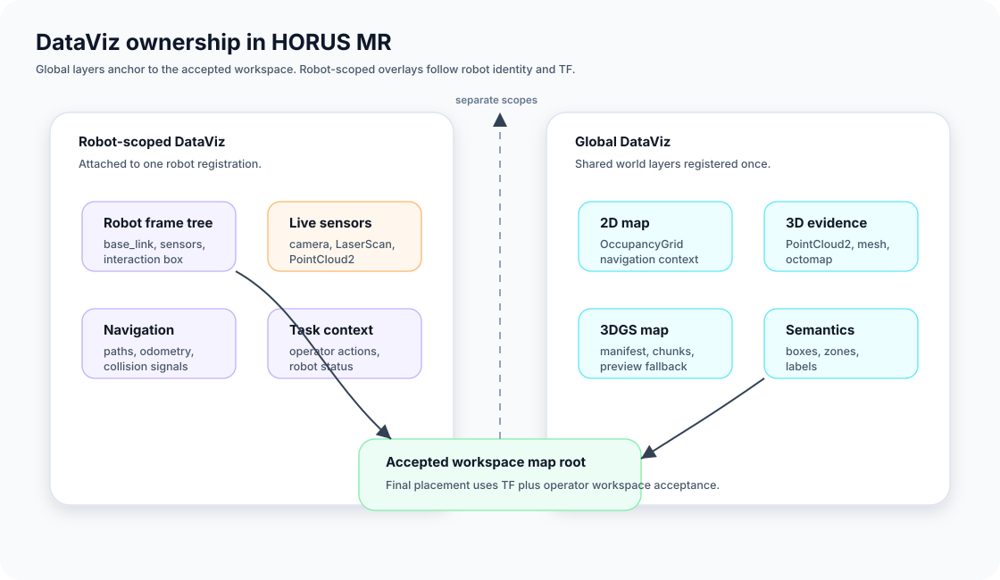

# DataViz

## When to use it

Use `DataViz` when you need to declare what an operator should see in HORUS MR beyond the robot body itself: paths, odometry trails, collision alerts, maps, and semantic layers.

Keep two scopes separate:

- robot-scoped overlays belong on the robot's own `DataViz`
- shared world layers belong on one global `DataViz`, usually the first one passed to `register_robots(...)`



That separation matters in MR because global maps are anchored to the accepted workspace, while robot-scoped layers follow robot identity and TF.

## Minimal example

```python
dataviz = robot.create_dataviz()
robot.add_path_planning_to_dataviz(
    dataviz,
    global_path_topic="/atlas/global_path",
    local_path_topic="/atlas/local_path",
)
```

## Realistic example

```python
dataviz = robot.create_dataviz()

robot.add_navigation_safety_to_dataviz(
    dataviz,
    odom_topic="/atlas/odom",
    collision_risk_topic="/atlas/collision_risk",
)

dataviz.add_occupancy_grid(
    "/map",
    frame_id="map",
    render_options={
        "color_free": "#222222",
        "color_occupied": "#F4F4F4",
        "alpha": 0.85,
    },
)

dataviz.add_semantic_box(
    "person_1",
    "person",
    center=(1.6, 0.8, 0.9),
    size=(0.45, 0.45, 1.8),
    render_options={"color": "#00C853", "confidence": 0.92},
)
```

Use robot convenience helpers for common per-robot overlays, and direct `DataViz` methods for global layers such as occupancy, point clouds, meshes, octomaps, and semantic entities.

## Navigation costmaps

`add_costmap` adds an independent cost overlay, not another occupancy map.
Register local/global layers (and namespaced robot costmaps) together:

```python
dataviz.add_costmap("/global_costmap/costmap", frame_id="map", height_offset=0.008)
dataviz.add_costmap("/local_costmap/costmap", frame_id="map", height_offset=0.012)
```

The input is **full `nav_msgs/msg/OccupancyGrid` snapshots**, using Nav2's
occupancy encoding: free `0`, graded costs `1..98`, inscribed `99`, lethal `100`,
unknown `-1`. Free cells are transparent. The cost palette goes blue to red;
inscribed cells are cyan, lethal cells magenta. Unknown cells are hidden unless
`show_unknown_space=True`. Invalid cell values are yellow, not interpreted as free.
This is a visualization, not a collision checker or command-safety mechanism.

### Nav2 publisher settings

Set these parameters on **both** costmap nodes in your Nav2 configuration:

```yaml
global_costmap:
  global_costmap:
    ros__parameters:
      always_send_full_costmap: true
      publish_frequency: 2.0
local_costmap:
  local_costmap:
    ros__parameters:
      always_send_full_costmap: true
      publish_frequency: 5.0
```

Those rates are starting points, not measured capacity guarantees. Full grids
cost more bandwidth than patches. The headset directly consumes full
`nav_msgs/OccupancyGrid`; use the SDK adapter below for
`map_msgs/OccupancyGridUpdate`, `nav2_msgs/Costmap`, and raw updates. Default
Nav2 incremental-only publishing can otherwise leave a late-joining viewer
with an old full map. See the [Nav2 costmap publisher](https://github.com/ros-navigation/navigation2/blob/jazzy/nav2_costmap_2d/src/costmap_2d_publisher.cpp)
and [RViz costmap palette](https://github.com/ros2/rviz/blob/rolling/rviz_default_plugins/src/rviz_default_plugins/displays/map/palette_builder.cpp).

### Raw and incremental Nav2 maps

Run one adapter per layer, on the same ROS domain as Nav2. This example uses
Nav2's raw costmap and its `GetCostmap` snapshot service:

```bash
cd ~/horus_sdk
source /opt/ros/jazzy/setup.bash
PYTHONPATH=python:$PYTHONPATH python3 -m horus.mapping.ros_costmap \
  --input-topic /global_costmap/costmap_raw \
  --input-format raw \
  --updates-topic /global_costmap/costmap_raw_updates \
  --snapshot-service /global_costmap/get_costmap \
  --output-topic /horus/costmaps/global
```

Use another terminal for the local layer, changing `global_costmap` to
`local_costmap` and the output to `/horus/costmaps/local`. For occupancy-encoded
input, use `--input-format occupancy`, `/costmap` and `/costmap_updates`.
Topic and service names are configurable; inspect your Nav2 graph if it is
namespaced differently. This sends no motion commands and changes no Nav2 settings.

Register the normalized layers in a third terminal:

```bash
cd ~/horus_sdk
source /opt/ros/jazzy/setup.bash
PYTHONPATH=python:$PYTHONPATH python3 python/examples/incremental_costmap_registration.py
```

The adapter preserves every grid cell, frame, origin and resolution. Raw 0..255
costs use Nav2's normal visualization conversion to -1/0..100, including unknown,
inscribed and lethal cells; these are display costs, not occupancy probabilities.
Patches update only their rectangle. The output remains a full grid at up to
`--publish-hz 5`, so this reduces source-side publishing requirements, not the
headset wire format's full-grid bandwidth.

Incremental input requires `--snapshot-service`: the adapter starts from an
authoritative snapshot and resynchronizes every `--resync-seconds 2`. A cached
full map plus the last patch alone is not accepted as a complete late join.
The recovery journal is bounded to 64 messages / 8 MiB; overflow, malformed
updates or a reported DDS loss stop output until recovery succeeds. Missing
service replies time out after two seconds. Old displayed grids then follow the
normal headset stale timeout. Unreported upstream loss can remain until the next
snapshot, so this is a visualization path, not a safety-certified navigation map.
All publishers and the snapshot service must use the same clock, frame and map.
`--volatile-full` is available for non-latched full-grid sources.

`frame_id` is the **workspace fixed frame**, normally `map`, not a forced override
of the message frame. A grid in `odom` needs a connected `map -> odom` TF tree.
The message origin, rotation and resolution are respected, including rolling
windows. Missing/disconnected transforms hide the layer with a warning. For a
separate robot TF tree, pass `tf_topic="/robot_a/tf"`; its paired static topic is
`/robot_a/tf_static`.

Options: `alpha=0.65`, `show_unknown_space=False`, `height_offset=0.01`,
`stale_timeout=5.0`, `tf_topic="/tf"`. Height is a small lift in workspace metres
after workspace scaling; give overlapping layers different offsets. Costmaps
without a full snapshot for five seconds are hidden with a warning. Use
`stale_timeout=0` only for deliberately static snapshots, or increase it for a
slower publisher. Rendering uses the latest connected TF, not time-travel TF.

One retained update per topic and shared map-upload scheduling prevent an
unbounded costmap backlog. Layers use a one-byte-per-cell texture without
downsampling; the current guard is 4,194,304 cells and 4,096 cells per dimension
(also limited by the device texture limit). Larger grids are rejected explicitly.
This guard is not a performance promise. Re-registering the same topic updates
its settings; different topics coexist. Shared topics remain until their last
registration is removed. Do not register one topic as both occupancy and costmap:
the costmap is skipped to avoid replacing another visualizer's subscription.

### Standalone registration

With Nav2 running in the same ROS domain and the parameters above configured:

```bash
cd ~/horus_sdk
source /opt/ros/jazzy/setup.bash
PYTHONPATH=python:$PYTHONPATH python3 python/examples/costmap_registration.py
```

The SDK starts the HORUS bridge as usual. Connect the app and create a workspace.
This example registers only the two costmap layers, not an invented robot or
command interface. Edit the two topic names when Nav2 uses a robot namespace.
It requires a HORUS MR build containing the costmap visualizer; older APKs do
not display the new registration type. Python registration is supported here;
C++/Rust convenience-helper parity is not implied.

## Paths and trajectories

Navigation paths and executed trajectory history use `nav_msgs/Path`, not a
sequence of independently registered goal markers:

```python
dataviz.add_robot_trajectory(
    robot.name,
    topic="/atlas/trajectory",
    frame_id="map",
)

world_layers.add_global_navigation_path(
    topic="/mission/path",
    frame_id="map",
    render_options={"color": "#00C853", "line_width": 0.016},
)
```

HORUS MR keeps global planning, local planning, and trajectory history separate.
Robot path visibility also controls its trajectory history. A shared path is
anchored to the workspace and deduplicated by topic; removing one robot does not
remove a shared path still registered by another robot or workspace resource.
`header.frame_id` must identify a frame reachable in the registered TF tree.

## Global map families

| Method | Primary topic type | Best for |
| --- | --- | --- |
| `add_occupancy_grid(...)` | `nav_msgs/OccupancyGrid` | 2D navigation context |
| `add_costmap(...)` | full `nav_msgs/OccupancyGrid` cost snapshots | local/global navigation costs over the workspace |
| `add_3d_map(...)` | `sensor_msgs/PointCloud2` | direct 3D evidence and scan-derived maps |
| `add_3d_mesh(...)` | mesh marker or mesh map topic | solid world surfaces |
| `add_live_mesh(...)` | HMSH v2 adapter output | changed sections and requested repair only; see [Live Mesh Delivery](./live-mesh.md) |
| `add_3d_octomap(...)` | octomap mesh/native octomap topics | octomap-style map runtimes |
| `add_gaussian_splat_map(...)` | HORUS Gaussian splat manifest plus ROS chunks | experimental 3DGS visualization with pointcloud fallback |

Use the smallest map family that answers the operator's question. A dense visual layer is useful for inspection, but it costs more headset memory, GPU time, and registration debugging time than an occupancy grid.

## Pointcloud rendering options

PointCloud2 layers should normally use workspace-scaled point sizing so the same registration behaves correctly at tabletop and room scale:

```python
world_layers.add_3d_map(
    "/map_3d",
    frame_id="map",
    render_options={
        "point_size": 0.035,
        "auto_point_size_by_workspace_scale": True,
        "min_point_size": 0.0015,
        "max_point_size": 0.012,
        "point_shape": "circle",
        "render_mode": "opaque_fast",
        "render_all_points": True,
        "visible_points_budget": 120000,
        "max_visible_points_budget": 180000,
        "enable_view_frustum_culling": False,
        "map_static_mode": True,
    },
)
```

Use `point_shape="circle"` when square billboard corners overlap and make the map look like flat panels. Keep `render_mode="opaque_fast"` unless you specifically need transparency; it is the preferred Quest path.

Point-cloud `render_options` also accept `color_mode`: `rgb` (default, source
colour or the configured flat fallback), `flat`, `height`, or `rgb_height`
(source RGB when available, otherwise height). Set `height_min_m` and
`height_max_m` for a fixed purple-to-red rainbow; defaults are -1 and 2 metres.
Height is source-frame Z for ENU clouds, or negative Y for optical clouds, before
workspace scaling. It is not automatically transformed into world elevation.
Use map-frame points for a world-height palette. Colours are clamped outside the
range and do not change the source points, density or map materials. The same
options work for `add_sensor_visualization(lidar, ..., render_options=...)`.

## Gaussian splat maps

`render_options["preserve_source_detail"] = True` selects full-resolution splat
targets, float32 SH, no SH LOD, four-pass per-frame sorting and zero contribution
cull threshold in the matching MR runtime. In this mode `max_splats` is an
admission limit: oversized assets fail explicitly instead of loading a prefix.
This is opt-in and more expensive than the existing defaults. After changing
load settings, the next manifest announcement reloads cached data. It does not
remove device limits or change the experimental stereo rendering contract.

Gaussian splat support is a HORUS DataViz path, not a separate viewer. The SDK registers a small manifest topic and receives the asset over ROS chunk topics, matching the rest of the HORUS registration workflow.

```python
world_layers.add_gaussian_splat_map(
    manifest_topic="/horus/gaussian_splat/manifest",
    frame_id="map",
    preview_topic="/map_gaussian_splat_preview",
    render_options={
        "render_mode": "splats",
        "max_splats": 350000,
        "render_scale": 0.5,
        "sh_order": 2,
        "half_precision_sh": True,
        "adaptive_sort": True,
        "sort_passes": 2,
        "splat_scale": 1.0,
        "contribution_cull_threshold": 0.1,
        "pointcloud_fallback": True,
    },
)
```

`render_mode` accepts:

| Value | Purpose |
| --- | --- |
| `splats` | normal Gaussian splat rendering |
| `debug_points` | fixed-size points for workspace anchoring checks |
| `mono_center_eye` | Quest/XR diagnostic mode for isolating stereo matrix issues |
| `no_covariance` | fixed-size splats for checking whether covariance expansion is causing distortion |

Keep `pointcloud_fallback=True` while developing. The fallback preview lets HORUS MR show the same map frame if splat loading, caching, or rendering fails.

## Common failure and fix

- **Failure:** maps or semantic layers appear duplicated or do not appear consistently across operators.
- **Fix:** keep workspace-level layers in global DataViz scope and make sure the intended topic is published by the runtime. For point clouds and dense maps, also verify render options such as point size, budgets, and culling policy.
- **Failure:** pointcloud maps look like large overlapping panels.
- **Fix:** use workspace-scaled sizing, smaller `min_point_size` / `max_point_size` clamps, and `point_shape="circle"`.
- **Failure:** a Gaussian splat layer does not appear, but the fallback pointcloud does.
- **Fix:** check the `/horus/gaussian_splat/manifest`, chunk topics, cache/hash logs in HORUS MR, and temporarily set `render_mode="debug_points"` to isolate loading from covariance and stereo rendering.
